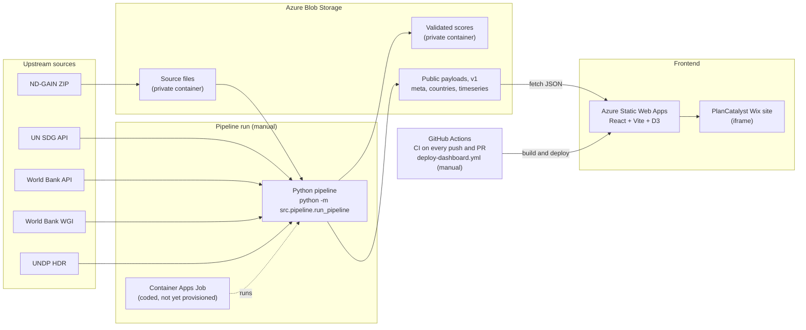
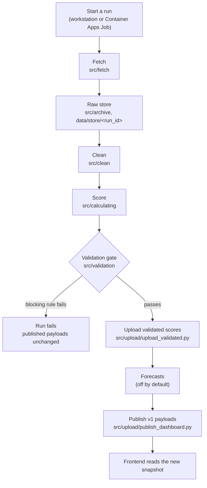

# Global Country Development Scoring Engine

PlanCatalyst's Global Country Development Scoring Engine scores development need for
216 countries across 7 pillars, 17 subdomains and 28 indicators, from 1990 to 2024. It
helps PlanCatalyst teams and partners see where need is highest and compare countries on
one consistent scale.

It is published inside PlanCatalyst's Wix site.

It is a decision-support tool for identifying country-level need, not an impact
attribution system.

## What it does

A Python pipeline pulls indicator data from five global sources, keeps a raw copy of
every run, cleans and scores it against the 7-pillar taxonomy in
`indicators/indicators.yaml`, and runs it through a blocking validation gate. Only a run
that passes publishes. The output is three versioned JSON payloads (`meta.json`,
`countries.json`, `timeseries.json`) in Azure Blob Storage. A React frontend reads only
those payloads, so the backend and frontend meet at one contract
(`docs/data-contract.md`). Missing observations stay `null` rather than a sentinel
value.

## Architecture



Pipeline output lives in Azure Blob Storage. The frontend is a static React app on Azure
Static Web Apps, embedded in PlanCatalyst's Wix site. GitHub Actions runs CI on every push
and deploys the frontend only when dispatched by hand. Refresh is manual: see
`docs/runbook-refresh.md` for the run and the Container Apps Job, and
`docs/data-contract.md` for the payloads.

## Data flow



A failed run never overwrites known-good output: validation blocks before anything is
uploaded, and the publish step writes the data payloads first and `meta.json` last, so
the frontend never picks up a half-written snapshot. `projections.json` is
written only when forecasts are turned on.

## Stack

- **Pipeline:** Python (pandas, PyYAML, Azure Storage SDK), packaged as a Docker image
- **Frontend:** React, TypeScript, Vite, D3
- **Cloud:** Azure Blob Storage, Azure Static Web Apps; Azure Container Apps and
  Container Registry for the refresh job
- **CI/CD:** GitHub Actions, CodeQL
- **Sources:** UN SDG API, World Bank API, World Bank Worldwide Governance Indicators,
  UNDP Human Development Reports (GII, MPI), ND-GAIN

## Running it

`RUNNING.md` covers local setup: the Python environment, `.env` values, dry-run versus
live publish, and the frontend dev server. The short version:

```zsh
python3 -m venv .venv && source .venv/bin/activate
pip install -r requirements.txt
python3 -m src.pipeline.run_pipeline      # fetch, clean, score, validate, publish

cd dashboard && npm install && npm run dev
```

## Documentation

- `RUNNING.md`: local setup and run modes
- `HANDOFF.md`: project context and implementation history
- `TASKS.md`: remaining work
- `docs/data-contract.md`: the backend-to-frontend payload specification
- `docs/runbook-refresh.md`: how to run the six-month refresh
- `docs/data-quality-issues.md`: validation rules and open data-quality decisions
- `docs/repo-architecture.md`: repository layout
- `docs/docker.md`: the pipeline container
- `docs/PRINCIPLES.md`: mission and operating constraints
- `indicators/indicators.yaml`: indicator taxonomy and metadata
- `indicators/SCORING_AUDIT.md`: scoring-direction audit

## Maintainer

Thomas Llamzon: pipeline, Azure, frontend and the Wix integration.
